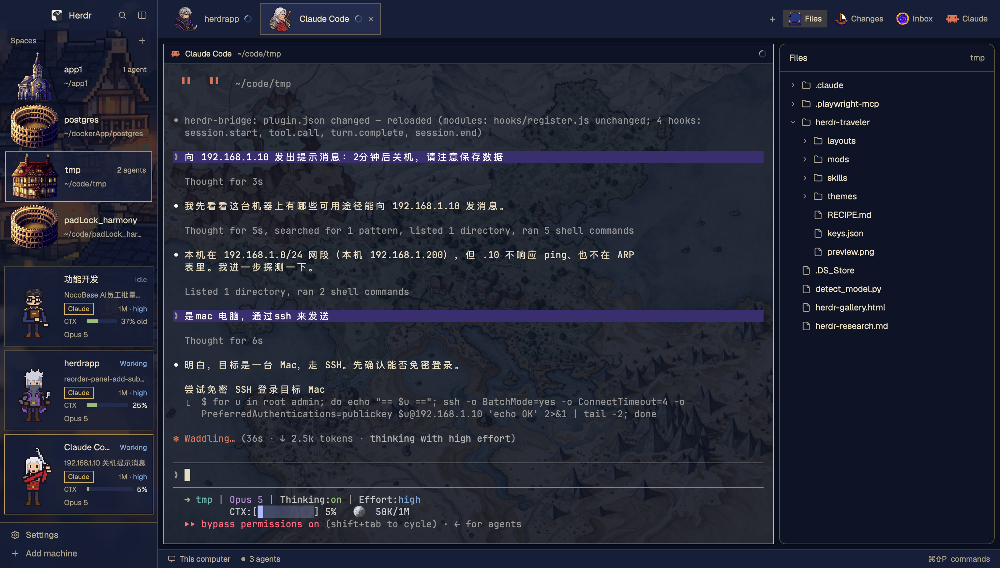

# Traveler

一个"旅行者"主题的 Herdr 布局:左侧是地图质感的侧栏(空间与 agent 职业卡片),中间是低透明度、地图背景的终端工作区,右侧是可折叠的面板(Files / Changes / Inbox / Claude 状态)。无系统标题栏,深蓝暮色主题。



## What you see

**窗口**:无系统标题栏(`titlebar: none`);macOS 左上角红绿灯占位 `traffic_lights: [12, 16]`。整体背景 `canvas`,主题 `traveler-dusk`(深蓝暮色),终端文字半透明(`terminal_opacity: 0.6`)。

**左侧栏** `sidebar`,268px 宽(可拖到 44–480),背景是 `mods/traveler-chrome/sidebar.png`(cover)。窄于 160px 时全部 mod 自动变成紧凑 rail(只留图标)。从上到下:

- **brand** 46px,窗口可拖拽(`window_drag`)。宽时:20px Herdr 头像 + "Herdr" 字、搜索按钮、侧栏折叠按钮;macOS 红绿灯窄栏时让位。
- **Spaces** 列表(占 1 份,min 90px):每行 76px,稳定彩色地点头像(宫殿 / 宅邸 / 教堂 / 斗兽场四选一),空间名 + "n agents" 计数 + 项目路径(短化 `~`),行尾 git 尾巴(`repo · branch`,unpushed `↑n` 绿 / 未拉取 `↓n` 红)。worktree 以 28px 行嵌套在它的仓库行下(`└─`/`├─`)。行首 31px 是 "Spaces" 标题 + 新建按钮。
- **Agents** 列表(占 1 份,min 90px):每张卡片 72×96px 职业肖像(8 职业,3 状态 gif sprite),tab 名 + 状态文本,程序标签(Claude 金色 / builder 紫色),CTX 条 + 模型名。blocked 时整卡红框红字。
- **footer** 69px:`Settings` 行(有更新时带 accent 圆点)、`Add machine` 行。

**中间工作区** `work`(column):

- **tabs** 58px(`traveler-tabs`):tab 卡片 48px 高,显示程序图标或职业肖像、名字、"Z"(zoomed)、working spinner、blocked/done 圆点;末尾 `+` 打开新建菜单,然后是右侧面板按钮 `Files / Changes / Inbox / Claude`,最后是窗口按钮(最小化 / 最大化 / 关闭)。
- **主区域** `main`:当前 tab 的终端,背景 `mods/traveler-chrome/map.png`(cover)。每个 pane 有 30px 顶部 header(`pane` mod,始终显示),边框 1px `#c9a96199`(半透明),聚焦时换主题 accent;`gap: 8`,单 pane 也有框(`lone: true`)。
- **右侧面板** `panel`,368px(280–900),**默认隐藏**。stack `panel-body` 四个页签:`Files`(`my-files`)、`Changes`、`Inbox`、`Claude`(`claude-status`)。
- **状态栏** `status` 28px(`workspace-status`)。

**Claude 面板**:聚焦 Claude Code 终端时,从上到下显示 **TASKS** / **SUBAGENTS** / **MCP** / **SESSION** 四块(标题为 accent 加粗,块间 1px 分割线);TASKS 与 SUBAGENTS 没有内容时整块隐藏,标题也不出现。聚焦 shell 或其它程序时显示一行灰字"暂无信息"。

## How it behaves

- **空间**:左键切换;右键打开空间菜单;拖拽重排(目标行显示 2px accent 线,跨机器不可拖);worktree 空间自动嵌套在其仓库空间之下。多机器时按机器分组,机器头可点击折叠(存 `machines.folded`),头上有 `+` 新建该机器空间。git 状态(分支 / ahead / behind / dirty)由 `git status --porcelain=v2` 读取,事件驱动 + 最长 60s 兜底刷新。
- **Agent 卡片**:`working` 状态字 + 卡片;`blocked` 红框红字(等你);`done` / `idle` 各自主题色。点击卡片 `agent.focus` 聚焦该会话。CTX 条按上下文占用分级变色(与 Claude Code 状态条一致):<60% 绿、60–80% 黄、≥80% 红,无数据显示" —"。effort 按等级着色:`low` 黄、`medium` 绿、`high` 蓝、`xhigh` 紫、`max` 红。HP/SP 数值来自 `~/.claude/statusline.sh` 写的缓存,无数字只显示" —"。
- **Tab 卡片**:点击选中;按住拖拽移动;右键打开 tab 菜单;双击改名;滚轮切前后 tab。`+` 打开新建菜单(新终端 / 已装 agent)。
- **面板按钮**:点 `Files / Changes / Inbox / Claude` 切页签并展开面板;再点当前页签收起面板。`Claude` 按钮只在布局 stack 含 `claude-status` 页签时出现(包内 `traveler-tabs/main.js` 已带这个判断)。
- **快捷键**(`keys.json`,合并到你的 `layout:traveler` 段):
  - `cmd-shift-j` — 显示/隐藏右侧面板
  - `cmd-shift-u` — 切到 Claude 页签
- **Claude 面板**:按聚焦终端的 `foreground.pid` 匹配桥文件 `~/.claude/herdr-bridge/claude-<pid>.json`,从上到下显示 tasks(working spinner、完成 ✓、阻塞 `!`)、subagents(运行中转圈、完成 ✓、失败 ✗、等待空心点;每行是描述或名字 + 类型标签 + 状态)、MCP(已连接绿点 + tools 数,未连接红点 "no tools")、SESSION(版本 / 模型 / Session / Folder / Branch)。TASKS 与 SUBAGENTS 没有内容时整块隐藏;无桥插件时降级显示版本 / session / tasks,SUBAGENTS 为空,MCP 显示"暂无连接状态"。
- **侧栏**:窄于 160px 折叠成 rail;折叠按钮恢复之前宽度。

## Built from

布局节点树(`layouts/traveler.json`,theme `traveler-dusk`):

```
row root
├─ column sidebar (268px, min 44, max 480, 不可拖拽, sidebar.png cover)
│   ├─ block brand (46px, window_drag)            mod traveler-chrome
│   ├─ column sidebar-lists
│   │   ├─ block spaces (weight 1, min 90)        mod traveler-spaces
│   │   └─ block agents (weight 1, min 90)        mod traveler-agents
│   └─ block sidebar-footer (69px)                mod traveler-chrome, props { footer: true }
└─ column work (不可拖拽)
    ├─ block tabs (58px, window_drag)             mod traveler-tabs
    ├─ row work-body (padding 8, gap 8)
    │   ├─ block main                             tab active; pane header = pane(30px, top, always),
    │   │                                          背景 map.png, 边框 #c9a96199, 聚焦 accent, radius 0, gap 8, lone
    │   └─ column panel (368px, min 280, max 900, hidden)
    │       └─ stack panel-body (active: files)
    │           ├─ block files                    mod my-files
    │           ├─ block changes                  mod changes (自带)
    │           ├─ block inbox                    mod inbox
    │           └─ block claude-status            mod claude-status
    └─ block status (28px)                        mod workspace-status (自带)
```

自定义 mod(本包提供,各在 `mods/<name>/`):

- **traveler-chrome** — brand 栏与 footer(`props().footer`);`toggleSidebar` 用 `layout.resize` 折叠侧栏,宽度阈值 160px。
- **traveler-spaces** — 空间列表;`places.json`(本机数据,不打包)映射地点头像;git 用 `exec("git", ["--no-optional-locks", "-c", "core.fsmonitor=false", "status", "--porcelain=v2", "--branch"], { cwd, on })`;`watchFolder` 监听本地 repo;机器列表 `hc machine ls --json`。
- **traveler-agents** — agent 职业卡片;读 `appHome()/data/traveler/sessions` 的 statusline 缓存(`readTextFile` + `watchFolder`);`setAgentOrder` 把列表顺序交给 `agent.next`/`agent.prev`。
- **traveler-tabs** — 顶部 tab 卡片与面板按钮;`assignJobs`/`tabNames` 来自 `lib.js`;`syncPanel` 按空间记忆右侧面板页签(布局含 `claude-status` 页签时跳过恢复);Claude 按钮 `panelButton("claude-status", "Claude", "icons/claude.svg")`。
- **my-files** — 克隆自自带 `files`(0.1.13),Files 面板。
- **inbox** — Inbox 面板;列出 `appHome()/data/inbox/files` 下白名单后缀(png/jpg/jpeg/webp/gif/mp4/mov/pdf)的文件,缩略图 + 大小 + 时间,点击用系统默认程序打开。`exec` 只跑 `ls`/`stat`/`open`(macOS)且参数走数组,不删档、不联网。
- **claude-status** — 右侧 Claude 状态面板;`hc(["get", addr, "--json"])` 拿聚焦终端 pid,读 `~/.claude/herdr-bridge/claude-<pid>.json`(含 `tasks` 与 `agents`),fallback 读 `~/.claude/sessions/<pid>.json` 与 `~/.claude/tasks/<sessionId>/`;250ms 轮询 + `render` 事件驱动检测焦点,面板不可见时不加载不重绘。

自带 mod 依赖:`changes`、`pane`(pane 头)、`workspace-status`、`menu`、`new-menu`、`picker`、`machine-add`,以及 `workspace-chrome` 的图标(`branch.svg`、`server.svg`、`monitor.svg`、`plus.svg`、`chevron-*.svg`、`spinner.svg`)和 `icons/claude.svg`。

`herdr` 函数:`spaces / agents / panes / focused / theme / layout / shared / setShared / window / settings / appHome / home / updates / readTextFile / watchFolder / exec / hc / run / openOverlay / setAgentOrder / props`。

命令:`space.select / space.new / space.move / space.close`、`agent.focus`、`layout.resize / layout.toggle / layout.show / layout.select`、`pane.split`、`tab.new / tab.select / tab.move / tab.rename / tab.close`、`window.minimize / maximize / close`、`app.settings`、`mod.open`。

Claude 侧依赖:**`skills/herdr-bridge`**(Claude Code 插件,放进 `~/.claude/skills/herdr-bridge/`,需要 Claude Code ≥ 2.1.287;`$.agent.list()` 的 `idle`/`waiting` 状态需 2.1.289+)。它每 5 秒和工具调用后原子写 `~/.claude/herdr-bridge/claude-<pid>.json`;快照里的 `tasks` 与 `agents`(子代理 / teammate 的 id、name、description、type、status)供 Claude 面板读取。

## Watch out

- 布局克隆自 Herdr 自带 `main`(0.1.11),`cloned_from` 保留。目标机已有同名 `traveler` 布局会冲突,先备份再覆盖。
- `my-files` 克隆自自带 `files`(0.1.13)。目标机 Herdr 版本差异可能让 Files API 不匹配,那时从自带 `files` 重新克隆。
- `traveler-tabs` 需要两处补丁(Claude 按钮 + `syncPanel` 对 `claude-status` 页签的跳过)。本包的 `main.js` 已含补丁,**直接用包内文件,不要用目标机原有版本**。
- `claude-status` 依赖 `herdr-bridge` 插件,否则 MCP 只显示"暂无连接状态";已运行的 Claude 会话要 `/reload-plugins` 或重启才加载插件。
- **桥接插件的生效条件**:
  - 仅 macOS / Linux —— 原子写用 `/bin/mv`;Windows 上插件无法写文件,claude-status 自动降级(版本 / session / tasks 可用,MCP 显示"暂无连接状态")。
  - 需要 Claude Code ≥ 2.1.287;`--safe-mode` / `--bare` / 禁用 hooks 时插件不加载。
  - 插件放在 `~/.claude/skills/` 会在**所有**新 Claude 会话自动加载;每 5 秒检查一次、内容变化时(工具调用 / 回合结束)立即写、无变化时每 30 秒心跳写一次,每次约 1KB 的原子写(`.tmp` + `/bin/mv`);不想全局加载,在 `enabledPlugins` 设 `"herdr-bridge@skills-dir": false`。
  - 插件只写版本 / 模型 / MCP 连接状态 / tasks / 子代理(id、name、description、type、status),**不写凭据、prompt 或对话内容**;桥接只覆盖本机会话,Herdr 的远程机器终端不桥接。
  - 即使插件没加载,claude-status 仍能用 fallback 显示版本 / session / tasks;MCP 数据是唯一需要插件的部分。
- 主题必须放到 `themes/traveler-dusk.json`,否则布局 fallback 到默认主题。
- 右侧面板**默认隐藏**,用 `cmd-shift-j` 或右上角 Claude 按钮打开。
- 无系统标题栏;macOS 靠 `traffic_lights: [12, 16]` 留红绿灯空间,Windows/Linux 的窗口按钮由 `traveler-tabs` 顶部栏绘制。
- agent 的 HP/SP 依赖 `~/.claude/statusline.sh` 写缓存到 `appHome()/data/traveler/sessions`;没有该缓存时只显示" —"。
- `keys.json` 合并进 `~/.config/herdr-app/keys.json`(合并到 `layout:traveler` 段),不要整体覆盖用户文件。
- 面板宽度 368px、侧栏 268px、tabs 58px、status 28px 是布局写死的尺寸,`terminal_padding [14,12]`、`terminal_opacity 0.6` 影响终端留白与透出背景。

## Done when

1. `herdr-app check` 通过全部 7 个自定义 mod:`traveler-chrome`、`traveler-spaces`、`traveler-agents`、`traveler-tabs`、`my-files`、`inbox`、`claude-status`。
2. 切换布局到 `traveler`:左侧栏(品牌 + Spaces + Agents + footer)、顶部 tab 栏、终端主区、状态栏出现;右侧面板隐藏。
3. 右上角依次是 `Files / Changes / Inbox / Claude` 四个按钮;点 `Claude` 展开面板并停在 Claude 页签,点其它页签不报错。
4. `cmd-shift-j` 显示/隐藏面板,`cmd-shift-u` 切回 Claude 页签。
5. 聚焦一个 Claude Code 终端:Claude 面板从上到下为 TASKS / SUBAGENTS / MCP / SESSION;没有任务或子代理时对应整块(含标题)不出现;派发一个子代理时 SUBAGENTS 出现一行,带描述、类型与状态。聚焦 shell 或其它程序:显示"暂无信息"。
6. `claude plugin validate ~/.claude/skills/herdr-bridge` 通过;`~/.claude/herdr-bridge/` 下有 `claude-<pid>.json`,且包含 `tasks` 与 `agents` 字段。
7. Spaces 列表显示地点头像与 git 尾巴;Agents 列表显示职业肖像卡片;两者点击/切换正常。
